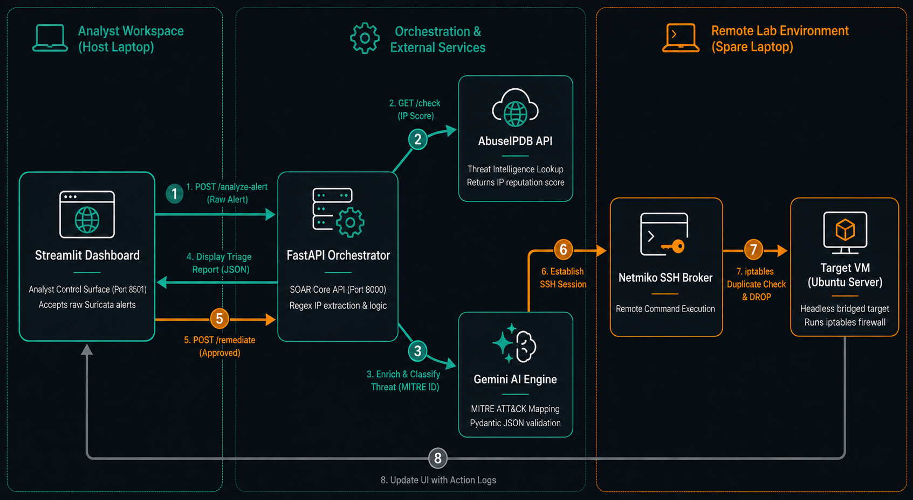

# Week 12: Full System Integration — The SOAR Grand Finale

## Objective
Consolidate twelve weeks of modular engineering into a cohesive, closed-loop **Security Orchestration, Automation, and Response (SOAR)** platform. The system automatically ingests live Suricata network intrusion alerts from a remote sensor, enriches them with external threat intelligence, classifies them against the MITRE ATT&CK matrix using Google Gemini AI, and executes remote firewall blocks across the physical network — all surfaced in real time through an automated analyst dashboard.

---

## Environment & Component Matrix

| Component | Role | Technology Stack |
|---|---|---|
| **Sensor Node (Target VM)** | Network Intrusion Detection & Enforcement | Ubuntu Server 24.04, Suricata NIDS, Linux Kernel `iptables` |
| **Workstation (Controller)** | Development & Orchestration Host | Windows Subsystem for Linux (WSL), Python 3.12 venv |
| **Log Shipper** | Real-Time SSH Streaming Agent | `log_collector.py` (Paramiko, Requests) |
| **Orchestration Backend** | Central REST API & Queue Engine | FastAPI (`SOAR Active Defender API`, v4.1.0), Uvicorn |
| **Analyst Console** | Auto-Refreshing Web Dashboard | Streamlit (`@st.fragment` live polling) |
| **External Integrations** | Threat Intel & Cognitive Triage | AbuseIPDB REST API v2, Google Gemini API (`gemini-3.6-flash`), Netmiko |

---

## Architecture — Modular Design

The platform uses single-responsibility modules to isolate network operations, API queries, and AI processing:

<<<<<<< HEAD
```text
[Attacker: Kali VM]
        │  attack traffic
        ▼
[Sensor: Ubuntu VM + Suricata] ── writes /var/log/suricata/fast.log
        │  SSH streaming tail
        ▼
[log_collector.py]  filters IPv6 noise, forwards IPv4 alerts
        │  POST /analyze-alert
        ▼
[main.py · FastAPI]  regex source-IP extraction · incident queue
        │                              │
        ▼                              ▼
[threat_check.py]               [ai_analyst.py]
 AbuseIPDB API                   Gemini · MITRE ATT&CK
        │                              │
        └──────────────┬───────────────┘
                       ▼
          [app.py · Streamlit console]
          polls GET /alerts every 3s · analyst approval
                       │  POST /remediate
                       ▼
          [firewall_test.py]
          Netmiko SSH → iptables -C / -A ... -j DROP
                       │
                       ▼
          [Sensor: Ubuntu VM · kernel firewall]
=======
| File | Responsibility |
|---|---|
| `threat_check.py` | AbuseIPDB reputation lookup — isolated, reusable function |
| `firewall_test.py` | Netmiko SSH automation — duplicate-checked `iptables` blocking |
| `ai_analyst.py` | Gemini AI threat classification — structured MITRE ATT&CK mapping |
| `main.py` | FastAPI orchestrator — imports all modules, exposes two endpoints |
| `app.py` | Streamlit dashboard — the analyst-facing control surface |

---

### System Architecture & Orchestration Pipeline



*Figure: Complete 8-step data flow across physical and virtual zones—from raw alert ingestion in the Streamlit UI, through API enrichment and AI threat mapping, to remote firewall enforcement via Netmiko SSH.*

---

## Key Implementation

**New capability — raw alert parsing.** Unlike previous weeks (which took a pre-extracted IP as input), the orchestrator now accepts a raw, unparsed Suricata alert string and extracts the attacker's IP itself:
```python
def extract_ip_from_text(text: str) -> str:
    ip_pattern = r'\b(?:[0-9]{1,3}\.){3}[0-9]{1,3}\b'
    ips = re.findall(ip_pattern, text)
    ...
    # filters out the target's own IP, localhost, and broadcast addresses
>>>>>>> 16a764aae3923c6e1d0580827ca59ef3865dd97d
```

| File | Primary Responsibility |
|---|---|
| `log_collector.py` | Connects to the sensor via SSH, tails `fast.log` in real time, filters background IPv6 chatter, and auto-forwards actionable IPv4 alerts to FastAPI. |
| `threat_check.py` | Queries the AbuseIPDB API for reputation scores, geolocation, and ISP data. |
| `firewall_test.py` | Manages Netmiko SSH sessions to the sensor; runs `iptables -C` to verify idempotency before applying `iptables -A ... -j DROP`. |
| `ai_analyst.py` | Sends alert payloads to `gemini-3.6-flash` and enforces a validated Pydantic schema mapping to MITRE ATT&CK tactics and technique IDs. |
| `main.py` | Central FastAPI orchestrator; extracts source IPs via regex, manages an in-memory incident queue, and exposes REST endpoints. |
| `app.py` | Streamlit frontend utilizing isolated fragments (`@st.fragment`) to auto-poll the incident queue every 3 seconds without full-page reloads. |

---

## Key Technical Implementations

### 1. Automated Log Streaming Pipeline (`log_collector.py`)
Rather than requiring manual alert entry, a persistent background agent streams raw alerts directly from the remote sensor over SSH:

```python
# Stream newly appended lines in real time over SSH
stdin, stdout, stderr = ssh.exec_command("sudo tail -n 0 -f /var/log/suricata/fast.log", get_pty=True)

for line in stdout:
    alert_text = line.strip()
    # Filter empty lines, sudo prompts, and background IPv6 multicast chatter
    if not alert_text or "password" in alert_text.lower() or "ipv6" in alert_text.lower():
        continue
    if not re.search(r'\b(?:[0-9]{1,3}\.){3}[0-9]{1,3}\b', alert_text):
        continue
    requests.post("http://127.0.0.1:8000/analyze-alert", json={"raw_alert": alert_text})
```

### 2. Context-Aware Regex Extraction (`main.py`)
To isolate the attacker's IP from Suricata's directional syntax (`SRC_IP:PORT -> DST_IP:PORT`), the orchestrator extracts the source address on the left side of the arrow while filtering out the sensor's internal IP and loopback addresses:

```python
def extract_ip_from_text(text: str) -> str:
    src_match = re.search(r'([0-9]{1,3}(?:\.[0-9]{1,3}){3})(?::\d+)?\s*->', text)
    if src_match:
        return src_match.group(1)
    ...
```

### 3. Asynchronous Dashboard Auto-Polling (`app.py`)
To prevent full-page flickering while waiting for alerts, the dashboard wraps the incident feed inside an isolated Streamlit fragment that polls the backend every 3 seconds:

```python
@st.fragment(run_every=3)
def live_incident_feed():
    res = requests.get(f"{BACKEND_URL}/alerts")
    # Dynamically renders incident cards and handles one-click remediation
    ...
```

---

## Visual Verification & Milestones

### 1. Live SOAR Dashboard Feed
The dashboard updates automatically as Suricata flags suspicious traffic, displaying the extracted IP, AbuseIPDB metrics, Gemini MITRE mapping, and the mitigation control button.


*Figure 1: Streamlit console displaying an auto-ingested incident with live threat intelligence and MITRE classification.*

### 2. Multi-Process Orchestration in WSL
The complete automated pipeline running across three coordinated terminal sessions: Uvicorn API server, Log Shipper agent, and Streamlit frontend.


*Figure 2: Terminal tabs showing the Log Shipper forwarding an alert, FastAPI processing the analysis pipeline, and the clean `200 OK` responses.*

### 3. Remote Sensor Kernel Verification
Direct SSH console on the Ubuntu Server VM verifying that the automated block was applied at the Linux kernel level.


*Figure 3: Output of `sudo iptables -L INPUT -n -v` confirming the active DROP rule for the blocked IP.*

---

## Milestone Summary

✅ **Closed-Loop Attack and Defense Simulation:**

1. Launched an attack probe from the Kali VM (`192.168.100.38`) against the Ubuntu VM (`192.168.100.41`).
2. Suricata logged the activity to `fast.log`.
3. `log_collector.py` intercepted the event and shipped it to FastAPI in near real time.
4. FastAPI retrieved live AbuseIPDB metrics and prompted Gemini AI to classify the attack into MITRE **T1046** (Network Service Discovery) / **T1110** (Brute Force).
5. The Streamlit dashboard auto-rendered the incident card via its 3-second polling fragment.
6. Clicking **Approve Automated Block** initiated a Netmiko SSH session, validated idempotency (`iptables -C`), applied the DROP rule, and marked the incident as resolved.

---

## Key Learnings & Engineering Principles

- **Decoupled architecture enables extensibility:** Separating sensor ingestion, REST processing, AI logic, and presentation ensures each module can be modified or replaced (e.g., swapping Suricata for Zeek, or Streamlit for React) without breaking the core pipeline.
- **Idempotency in security automation:** In automated remediation, checking whether a rule exists before appending prevents firewall table bloat and unintended resource exhaustion.
- **Strict type validation as a defensive layer:** Enforcing Pydantic schemas at both the API boundary (`IPvAnyAddress`) and the AI boundary (`MitreThreatAnalysis`) eliminates command injection vulnerabilities and ensures predictable, parseable responses from large language models.
- **Human-in-the-loop (HITL) design:** While automated detection and enrichment happen in seconds, placing a deliberate analyst approval step before firewall execution balances automation speed with operational stability.
